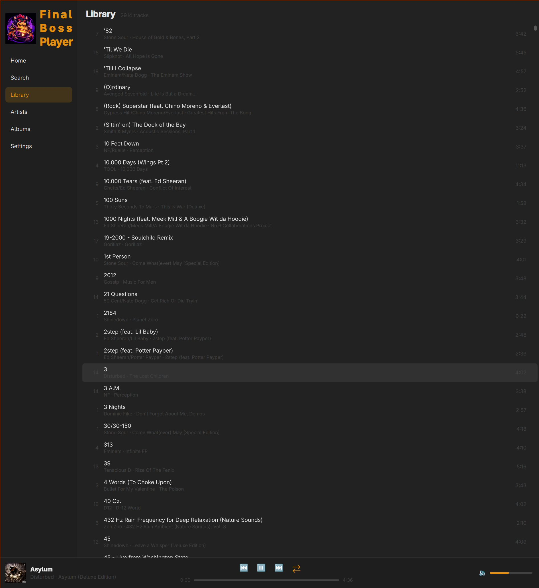
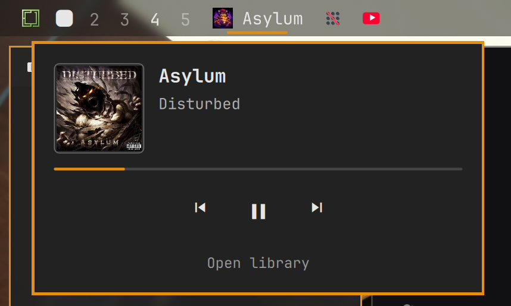

# Final Boss Player

<p align="center">
  
</p>

<p align="center">
  <strong>Your NAS. Your Music. Always Playing.</strong><br/>
  Lightweight Omarchy / Quickshell music player for local and NAS libraries.
</p>

<p align="center">
  <a href="https://omarchy.org/">Omarchy</a> ·
  <a href="docs/MANUAL.md">User manual</a> ·
  <a href="docs/MARKETPLACE.md">Marketplace listing</a> ·
  <a href="LICENSE">MIT</a>
</p>

Final Boss Player indexes music folders you already have mounted (SMB/NFS/local),
streams audio from disk without copying the library, and keeps a small SQLite
index on your machine. The UI is an Omarchy shell plugin (bar mini-player +
panel); playback runs in a Rust daemon (`finalbossd`) with MPRIS media-key
support.

| | |
| --- | --- |
| **Display name** | Final Boss Player |
| **Plugin id** | `io.github.finalboss.player` |
| **Daemon** | `finalbossd` |
| **License** | MIT |

## Screenshots

The library panel, with the track list and the player bar along the bottom.

<p align="center">
  
</p>

The bar mini-player, opened from the shell bar while a track is playing.

<p align="center">
  
</p>

## Install (Omarchy)

Requires [Omarchy](https://omarchy.org/) (Quickshell shell), a Rust toolchain
(`rustup` / `cargo`), and a working audio stack (PipeWire/Pulse).

```sh
# 1. Install the shell plugin
omarchy plugin add https://github.com/wieisdebaas/finalboss-player.git --enable

# 2. Build and enable the playback daemon (systemd --user)
cd ~/.config/omarchy/plugins/io.github.finalboss.player
./scripts/install.sh

# 3. Reload the shell and place the widget on the bar if needed
omarchy-restart-shell
```

Open **Final Boss Player** from the bar → **Settings** → add a music folder path
(for example `/mnt/nas/Music`).

### Check status

```sh
systemctl --user status finalbossd
journalctl --user -u finalbossd -f
omarchy plugin list | grep finalboss
```

### Update

```sh
omarchy plugin update io.github.finalboss.player
cd ~/.config/omarchy/plugins/io.github.finalboss.player
./scripts/install.sh          # rebuild daemon after updates
omarchy-restart-shell
```

### Remove

```sh
cd ~/.config/omarchy/plugins/io.github.finalboss.player
./scripts/install.sh --uninstall
omarchy plugin remove io.github.finalboss.player --yes
omarchy-restart-shell
```

`install.sh --uninstall` removes the daemon binary, user unit, and plugin
symlink helpers. The SQLite index and artwork cache under
`~/.local/state/finalboss/` and `~/.cache/finalboss/` are left in place unless you
delete them yourself.

## Features

- Stream FLAC / MP3 / M4A / AAC / WAV / OGG from mounted NAS or local folders
- SQLite library index (artists, albums, tracks, search)
- Full panel: Home, Search, Library, Artists, Albums, Settings
- Persistent bottom player + bar mini-player
- Shuffle, seek, volume, mute, MPRIS media keys
- Timed I/O so a stalled share does not freeze the shell
- Omarchy theme colours

See the [user manual](docs/MANUAL.md) for shortcuts and troubleshooting.

## Dependencies

| Component | Needs |
| --- | --- |
| Plugin UI | Omarchy 4+ / Quickshell |
| Daemon | Rust (edition 2021), `cargo`, ALSA/PipeWire for playback |
| Optional | `playerctl` for CLI media control |

Formats: Opus and ALAC-in-M4A are indexed but may not play with the current
decoder (documented in the manual).

## Development

```sh
git clone https://github.com/wieisdebaas/finalboss-player.git
cd finalboss-player

# Link into Omarchy + build daemon
./scripts/dev-link.sh
./scripts/install.sh

# Daemon tests
cd daemon && cargo test && cargo clippy --all-targets -- -D warnings

# Validate plugin layout (required before publishing)
omarchy plugin validate .
```

Design and implementation notes live under `docs/superpowers/` for contributors.

## Discoverability

**Omarchy shell search aliases** (bar / plugin picker): `music`, `player`,
`finalboss`, `final boss`, `nas`, `audio`, `library`, `mpris`, `flac`, `local-music`.

**Marketplace tags** (see [docs/MARKETPLACE.md](docs/MARKETPLACE.md)):

- Category: `Desktop`
- Tags: `media`, `quickshell`, `bar`

**Suggested GitHub topics:** `omarchy`, `quickshell`, `music-player`, `nas`,
`hyprland`, `qml`, `rust`, `linux`, `mpris`, `flac`.

## Privacy

No accounts, no cloud, no online metadata lookups. Music stays on your mounts;
only a local index and small artwork thumbnails are written under your home
directory.

## License

[MIT](LICENSE) © 2026 Robin Smits
